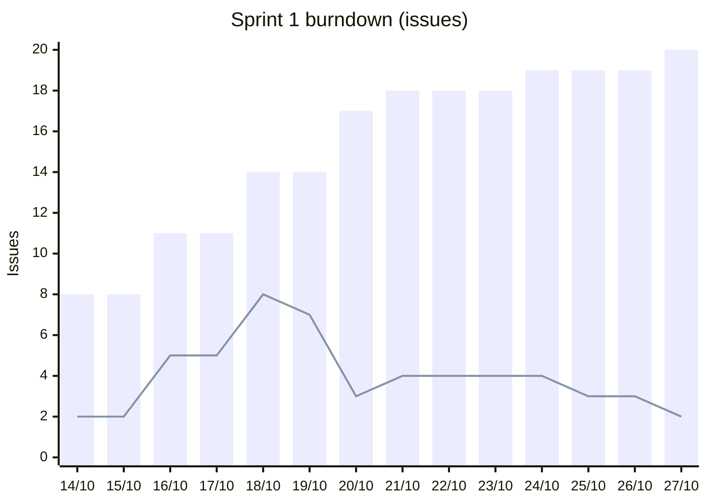

# Burndown Chart

Please present the burndown chart for each sprint.

## Sprint 1

Sprint 1 ran from 14/10/2026 to 27/10/2026. No story points were estimated in Sprint 1, so the chart counts Jira issues. "Scope" is the number of issues in the sprint on that day; "Remaining" is the number not yet done.

| Date | Scope | Done | Remaining |
|---|---|---|---|
| 14/10 | 8 | 6 | 2 |
| 16/10 | 11 | 6 | 5 |
| 18/10 | 14 | 6 | 8 |
| 20/10 | 17 | 14 | 3 |
| 21/10 | 18 | 14 | 4 |
| 24/10 | 19 | 15 | 4 |
| 25/10 | 19 | 16 | 3 |
| 27/10 | 20 | 18 | 2 |

Bars show scope, the line shows remaining issues.

**What the chart shows**

- The sprint started with 8 issues, 5 of them already done in Sprint 0.
- Scope grew from 8 to 20 issues during the sprint, as review and revision tasks were added after the first drafts.
- Most work closed on 20/10, when the canvas pages were merged.
- Two issues (DI502-35 and DI502-55, the architecture document) were closed on 28/10, one day after the sprint end date.

## Sprint 2

## Sprint 3

## Sprint 4
