# System Architecture Design Document

| Team | Sprint | Status | Last updated | Updated by |
|---|---|---|---|---|
| RagAgainstTheMachine | Sprint 1 | proposed | 2026-10-19 | Deniz Şenkutlu |

Decision records on this page are numbered **DEC-01, DEC-02, …** so that they are not confused with deliverables (D1–D16) or corpus documents (D01–D10).

## 1. Summary

The system is a Turkish question-answering assistant over Türkiye's current AI policy documents. It is built as retrieval-augmented generation (RAG), as set by the Project Review Committee (C-05). An **offline pipeline** extracts the 7 corpus documents (C-01, C-02), splits them into article- and section-level chunks, labels each chunk with its document, section, legal status, official URL and date, and stores them in a search index. At question time, a **web chat page** sends the user's question to the **RAG pipeline**. The pipeline retrieves the most relevant passages and asks a **language model** to answer only from those passages, citing the document and article or section. The page then shows the answer with each source's link, legal status and date, and the collection date (features F1–F6). Questions that are out of scope or need a case-specific legal assessment are declined with a referral to the competent authority (C-06). No personal data is stored (C-11). The same pipeline is run on the evaluation set, with results logged in Weights & Biases (C-13).

Charter: [Project Executive Summary](03-project-canvas/01-project-executive-summary.md) · [Assumptions & Constraints](03-project-canvas/03-assumptions-and-constraints.md) · [Major Activities](03-project-canvas/04-major-activities.md) · [Deliverables](03-project-canvas/05-deliverables.md)

## 2. Goals and non-goals

### Goals

| Charter objective | What the design must make possible |
|---|---|
| Objective 1: median answer time at most half the default state | Answers in one place, in Turkish, within a few seconds per question; follow-up questions without restating context |
| Objective 2: at least 25/30 correct and 27/30 cited | Retrieval that finds the gold passage; generation restricted to retrieved passages; citations with document and article/section |
| Objective 3: at least 7/10 would use again | A simple web page that needs no account or installation |
| Objective 4: at least 29/30 legal status correct | Legal status stored as metadata per chunk, taken from the document inventory, never generated by the model |
| Objective 5: at least 9/10 out-of-scope questions declined with referral | A refusal-and-referral rule in the prompt, plus a check when retrieval finds nothing relevant |

Success criteria are defined in the [Project Executive Summary](03-project-canvas/01-project-executive-summary.md), section 2.

### Non-goals

- Training or fine-tuning any model (C-05, C-09).
- Indexing anything outside the 7-document corpus, or updating the corpus automatically (C-01, C-03).
- User accounts, login or saved conversation history (C-08, C-11).
- Languages other than Turkish (C-04).
- Hosting after 30/12/2026 (C-10).
- High availability or many concurrent users; the expected load is the team plus 10 pilot participants.

## 3. System architecture diagram

**Version:** v1 (2026-10-19). Technologies marked *(spike)* are proposals that a learning spike will confirm (see section 7).

```mermaid
flowchart LR
    subgraph offline ["Offline ingestion pipeline (run once per collection date)"]
        src[("Official sources<br/>D01–D05, D08, D10")] -->|PDF + URL, date, SHA-256| ext["Extraction & cleaning<br/>Python, PyMuPDF (spike S1)"]
        inv[("Document inventory<br/>data/manifest.csv")] -->|legal status, URL, date| chunk
        ext -->|clean text per document| chunk["Chunker<br/>article/section-aware, Python"]
    end
    chunk -->|chunk text| emb["Embedding model<br/>multilingual (spike S2)"]
    emb -->|vectors| idx[("Search index<br/>Chroma + BM25 (spike S3)")]
    chunk -->|chunk text + metadata| idx

    user(["AI user<br/>public staff, researchers"]) -->|Turkish question| ui["Web chat page<br/>Streamlit (spike S5)"]
    ui -->|question + session history| rag["RAG pipeline<br/>Python package in src/"]
    rag -->|search query| ret["Retriever<br/>hybrid dense + keyword"]
    ret -->|query text| emb
    ret -->|vector + keyword search| idx
    idx -->|top-k chunks + metadata| ret
    ret -->|ranked passages| rag
    rag -->|prompt: rules + passages + question| llm["LLM<br/>Gemini on Vertex AI (spike S4)"]
    llm -->|answer with citation markers| rag
    rag -->|answer, sources, legal status, collection date| ui
    rag -->|question + answer text| pii["PII masker<br/>regex rules, Python"]
    pii -->|masked record| logs[("Interaction log<br/>Cloud Logging, no PII")]
    cfg[("config/rag.yaml<br/>prompts/")] -.->|parameters, prompt template| rag

    evalr["Evaluation runner<br/>Python script"] -->|40 eval questions| rag
    rag -->|answers + retrieved sources| evalr
    evalr -->|metrics, config, outputs| wandb[("Weights & Biases")]
```

The diagram renders on GitHub. The Confluence sync uploads it as a code block, so export a PNG for Confluence if the reviewers need the picture there.

## 4. Components

| Component | Responsibility | Technology and version | SBOM entry |
|---|---|---|---|
| Official sources | The 7 corpus documents as published by the data providers | PDF / web pages from the official sites (C-01) | `ai-bom.yaml` › documents (to add) |
| Document inventory | Legal status, official URL, download date and SHA-256 of each document | CSV in `data/manifest.csv` | `ai-bom.yaml` › documents (to add) |
| Extraction & cleaning | Turn each PDF into clean Turkish text; keep page numbers; apply the D05 page range and D08 Tedbir filter; load the hand-typed D04 | Python 3.12 + PyMuPDF *(spike S1)*; version pinned in `requirements.txt` | `ai-bom.yaml` › dependencies (to add) |
| Chunker | Split text at article/section boundaries, fall back to a fixed size for long sections, and attach metadata | Python (own code in `src/`); size and overlap in `config/rag.yaml` | `ai-bom.yaml` › code, config |
| Embedding model | Turn chunks and questions into vectors | Multilingual embedding model *(spike S2)*; candidates in DEC-04 | `ai-bom.yaml` › models (to add) |
| Search index | Store chunk vectors, text and metadata; answer vector and keyword searches | Chroma (persisted to disk) + BM25 keyword index *(spike S3)* | `ai-bom.yaml` › dependencies (to add) |
| Retriever | Combine dense and keyword results, return the top-k passages with metadata | Python (own code); `top_k` in `config/rag.yaml` | `ai-bom.yaml` › code, config |
| RAG pipeline | Rewrite follow-up questions, call the retriever, build the prompt, call the LLM, check citations, apply the refusal rule, attach legal status from metadata | Python package in `src/`; prompt templates in `prompts/` | `ai-bom.yaml` › code, prompts |
| LLM | Write the Turkish answer from the retrieved passages only | Gemini model on Vertex AI *(spike S4)*; exact model version pinned in `config/rag.yaml` | `ai-bom.yaml` › models (to add) |
| Web chat page | Question box, answers with source links, legal status and dates, collection date, "do not enter personal data" notice; session-only history | Streamlit *(spike S5)* | `ai-bom.yaml` › dependencies (to add) |
| PII masker | Mask T.C. ID numbers, e-mail addresses, phone numbers and IBANs before anything is logged | Python regex rules (own code) | `ai-bom.yaml` › code |
| Interaction log | Keep masked questions, answers, cited sources and latency for debugging | Google Cloud Logging (cloud); local file (alpha) | — (service) |
| Config and prompts | Hold every parameter and prompt template in version control | `config/rag.yaml`, `prompts/*.md` | `ai-bom.yaml` › config, prompts |
| Evaluation runner | Run the 40 evaluation questions through the pipeline and score retrieval and answers | Python script in `src/`; reads `docs/eval/eval-set-v1.csv` | `ai-bom.yaml` › code, eval_set |
| Weights & Biases | Store each run's config, outputs and metrics | Weights & Biases (SaaS) (C-13) | `ai-bom.yaml` › dependencies (to add) |

## 5. Design details

### Data pipeline

1. **Collect.** Download the 7 documents from their official sites. Record the URL, licence/terms of use, download date and SHA-256 in `data/manifest.csv` (C-03, A-05). The latest download date becomes the **collection date** shown to users (F6).
2. **Extract.** Extract text with PyMuPDF, keeping page numbers. D04 is typed in by hand. D05 is cut to PDF pages 642–806 and its recommendation tables are rebuilt as text. Only the AI-related Tedbir entries of D08 are kept, each with its number and responsible institution (C-02).
3. **Clean.** Fix hyphenation and line breaks, remove headers and footers, and check Turkish characters (ç, ğ, ı, İ, ö, ş, ü). Spot-check 10 random passages against the PDF; at least 9 must match word for word (A-04, D6).
4. **Chunk.** Split at the document's own structure (madde, bölüm, eylem, tavsiye or tedbir number), so that each chunk can be cited by article or section. Sections longer than the chunk size are split with overlap. Each chunk carries `doc_id`, `title`, `section`, `page`, `legal_status`, `doc_date`, `official_url`.
5. **Index.** Embed each chunk and store the vector, text and metadata in the search index; build the keyword index from the same chunks. The index is rebuilt only if the corpus or the chunking/embedding settings change, and it is versioned with the configuration that built it.

Legal status is **never generated by the model**. It comes from the document inventory, which a second team member checks and the Product Owner confirms at M4 (A-06).

No personal data enters the pipeline: the corpus consists of published official documents.

### Model

No model is trained. The LLM and embedding model are used as provided (C-05).

- **Follow-up questions (F4).** The last few turns of the open session are used to rewrite a follow-up into a standalone question before retrieval. History lives only in the page session and is gone when the page is closed or a new conversation starts (C-11).
- **Retrieval.** Hybrid search: dense vectors for meaning, plus keyword search for exact terms such as article numbers and institution names. The results are merged (e.g. reciprocal rank fusion) and the top-k passages are kept.
- **Prompting.** The prompt template (in `prompts/`) tells the model to:
  - answer in Turkish, only from the given passages;
  - cite each claim with a passage ID, which the pipeline turns into document, article/section and link;
  - say when a source is a plan, recommendation, report or bill rather than law in force (US-5);
  - when the passages do not contain the answer, or the question asks for a case-specific legal assessment or a prediction, decline and name the competent authority (C-06, F5);
  - for guidance the Action Plan promises but has not been published, say so and cite where it is promised.
- **Post-processing.** The pipeline checks that every citation refers to a retrieved passage, drops invalid ones, and attaches legal status, date and URL from the chunk metadata.
- **Refusal check.** If the best retrieval score is below a threshold (set in `config/rag.yaml` from the evaluation runs), the pipeline returns the referral answer without calling the LLM.

All of these settings (chunk size, overlap, models, top-k, threshold, prompt variant) live in `config/rag.yaml` (C-13).

### Evaluation

| Metric | How it is measured | Target / use |
|---|---|---|
| Answer correctness | Two team members compare each answer with the reference answer | ≥ 25/30 (Objective 2) |
| Citation support | The cited document and section support the answer | ≥ 27/30 (Objective 2) |
| Legal-status accuracy | The stated status of each cited source matches the inventory | ≥ 29/30 (Objective 4) |
| Refusal with referral | Out-of-scope and case-assessment questions are declined and the competent authority is named | ≥ 9/10 (Objective 5) |
| Retrieval recall@k | The gold source appears among the top-k retrieved passages | Diagnostic: separates retrieval errors from generation errors |
| Latency and cost per question | Logged per run | Must keep the pilot usable and within the $100 credit (C-09) |

- **Baseline.** The first end-to-end configuration, run on all 40 questions (D7). Every later experiment changes one setting in `config/rag.yaml` and is compared with it in `docs/eval/results.md`.
- **Test data kept separate.** `docs/eval/eval-set-v1.csv` is fixed before any experiment (C-13) and treated as the **test set**. Tuning on those same 40 questions would overstate the results. The team writes a small separate **development set** for tuning (see section 7).
- Every run is logged in Weights & Biases with its config, outputs and metrics, and linked from the experiment card.

### Interfaces

| From | To | What passes | Format or protocol |
|---|---|---|---|
| Official sources | Extraction & cleaning | Document files with URL, date and hash | PDF / HTML downloaded over HTTPS |
| Document inventory | Chunker | Legal status, URL and date per document | CSV (`data/manifest.csv`) |
| Extraction & cleaning | Chunker | Clean text per document with page numbers | UTF-8 text / JSON files |
| Chunker | Embedding model | Chunk text | Python call (local model) or HTTPS API (Vertex AI) |
| Embedding model | Search index | Vectors | Python call |
| Chunker | Search index | Chunk text and metadata | Python call; index persisted to disk |
| AI user | Web chat page | Turkish question | Browser over HTTPS |
| Web chat page | RAG pipeline | Question and session history | Python function call within the same app |
| RAG pipeline | Retriever | Standalone search query | Python function call |
| Retriever | Embedding model | Query text | Python call or HTTPS API |
| Retriever | Search index | Vector and keyword search | Python call |
| Search index | Retriever | Top-k chunks with metadata and scores | Python objects |
| Retriever | RAG pipeline | Ranked passages | Python objects |
| RAG pipeline | LLM | Prompt with rules, passages and question | HTTPS (Vertex AI API) |
| LLM | RAG pipeline | Answer text with passage IDs | JSON response |
| RAG pipeline | Web chat page | Answer, sources, legal status, dates, collection date | Python objects rendered as HTML |
| RAG pipeline | PII masker | Question and answer text | Python function call |
| PII masker | Interaction log | Masked record | Structured log line (JSON) |
| Config and prompts | RAG pipeline | Parameters and prompt template | YAML / Markdown read at start-up |
| Evaluation runner | RAG pipeline | Evaluation questions | Python function call; CSV input |
| RAG pipeline | Evaluation runner | Answers and retrieved sources | Python objects |
| Evaluation runner | Weights & Biases | Config, outputs, metrics | W&B Python SDK over HTTPS |

### Deployment

| Component | Alpha (Sprint 2, D8) | Beta and release candidate (Sprints 3–4, D10, D12, D15) |
|---|---|---|
| Offline pipeline | Team member's laptop | Team member's laptop; the built index is copied into the container image |
| Web chat page + RAG pipeline | Local web page on a team member's laptop (C-07) | One container on Google Cloud Run, reached through its HTTPS URL; scales to zero when unused |
| Search index | Local files | Files inside the container image (corpus is small and fixed) |
| Embedding model and LLM | Vertex AI API (or local embedding model) | Same as alpha |
| Interaction log | Local file, masked | Cloud Logging, masked |
| Evaluation runner + W&B | Laptop + W&B cloud | Laptop + W&B cloud |

Users reach the beta and release candidate through a browser only (C-08); there is no login. A Google Cloud billing budget alert is set before the first deployment (D10). Resources are listed in [Facilities & Resources](03-project-canvas/09-facilities-and-resources.md).

## 6. Decisions

### DEC-01: Use retrieval-augmented generation

**Context:** Answers must come from 7 official documents and cite them; the method is set by the Project Review Committee (C-05).

**Options considered:**

| Option | Pros | Cons |
|---|---|---|
| Keyword search only, no LLM (simplest) | Cheap, no hallucination | Returns passages, not answers; no multi-document answers |
| Put whole documents into a long-context LLM | No index to build | The selected corpus is still hundreds of pages; cost per question; weaker citations |
| Fine-tune an LLM on the corpus | Model "knows" the documents | Needs GPUs beyond the budget; cannot cite reliably; excluded by C-05 |
| RAG | Grounded answers with citations; cheap per question | Quality depends on retrieval |

**Decision:** RAG.

**Why:** Required by C-05, and it is the only option that gives cited answers within the budget.

**Consequences:** Retrieval quality becomes the main risk; recall@k is tracked separately from answer quality.

**Evidence:** Charter constraint C-05.

**Owner and date:** Muhammed Batuhan Tezcan (Product Owner), 2026-10-19

**Status:** accepted

### DEC-02: PDF text extraction with PyMuPDF; D04 typed by hand

**Context:** All corpus PDFs except D04 are assumed to have a correct Turkish text layer (A-04).

**Options considered:**

| Option | Pros | Cons |
|---|---|---|
| PyMuPDF | Fast, keeps page numbers, handles Turkish text layers | Tables need manual rebuilding |
| pdfplumber | Better table extraction | Slower |
| OCR (e.g. Tesseract) | Works without a text layer | Character errors in Turkish; not needed if A-04 holds |

**Decision:** PyMuPDF, with pdfplumber for the D05 tables if needed.

**Why:** Simplest option that meets the 9-of-10 spot check, if A-04 holds.

**Consequences:** If the spike shows a broken text layer, OCR or hand-typing is added for that document (risk R-04).

**Evidence:** Spike S1 (to do), D6 Dataset Report.

**Owner and date:** Utku Uçar, 2026-10-19

**Status:** proposed

### DEC-03: Structure-aware chunking

**Context:** Answers must cite the article or section (US-6).

**Options considered:**

| Option | Pros | Cons |
|---|---|---|
| Fixed-size chunks (simplest) | Easy | Cuts articles in half; citations become vague |
| Split at article/section boundaries, fixed-size fallback for long sections | Each chunk maps to one citable unit | Needs per-document parsing rules |

**Decision:** Structure-aware chunking with fixed-size fallback; size and overlap in `config/rag.yaml`.

**Why:** It makes the citation requirement straightforward.

**Consequences:** One parsing rule per document type (law, plan, report, programme).

**Evidence:** Baseline experiment (D7) and chunk-size experiments.

**Owner and date:** Utku Uçar, 2026-10-19

**Status:** proposed

### DEC-04: Embedding model

**Context:** Questions and documents are in Turkish (C-04); the legal vocabulary is specialised.

**Options considered:**

| Option | Pros | Cons |
|---|---|---|
| Open multilingual model run locally (e.g. multilingual-e5, BGE-M3) | No per-call cost; reproducible | Must be packaged with the app or run at query time on CPU |
| Vertex AI multilingual embedding model | Managed; same cloud and credit | Per-call cost; model versions can be retired |
| BM25 keyword search only (simplest) | No model at all | Misses paraphrased questions |

**Decision:** To be settled by spike S2: compare candidates on recall@k against the gold sources of the development set.

**Why:** —

**Consequences:** The chosen model and version go into `config/rag.yaml` and the AI-BOM.

**Evidence:** Spike S2 (to do).

**Owner and date:** Elif Yeşim Koçoğlu, 2026-10-19

**Status:** proposed

### DEC-05: Search index — Chroma plus BM25, stored in the app

**Context:** The corpus is small and fixed (C-01, C-03), and the budget is $100 (C-09).

**Options considered:**

| Option | Pros | Cons |
|---|---|---|
| In-process Chroma or FAISS + BM25, persisted to disk | Free; ships inside the container | Rebuilt and redeployed when the corpus changes |
| Vertex AI Vector Search | Managed, scalable | Needs a continuously deployed index endpoint billed by the hour; far more than the corpus needs |
| PostgreSQL + pgvector on Cloud SQL | Familiar SQL | An always-on database instance |

**Decision:** Chroma + BM25 (hybrid), persisted to disk and shipped with the app.

**Why:** Fits the corpus size and keeps the hosting cost close to zero when idle.

**Consequences:** Hybrid merge logic is written in the retriever.

**Evidence:** Spike S3 (to do).

**Owner and date:** Elif Yeşim Koçoğlu, 2026-10-19

**Status:** proposed

### DEC-06: LLM — Gemini on Vertex AI

**Context:** The model must write good Turkish, follow citation and refusal rules, and be paid for from the Google Cloud credit (C-09).

**Options considered:**

| Option | Pros | Cons |
|---|---|---|
| Gemini model on Vertex AI | Billed per token from the same credit; no GPU to run | External API; model versions are retired over time |
| Open-weight model on a cloud GPU | Full control | GPU hours would use up the $100 quickly |
| LLM API from another provider | Possibly stronger models | Not covered by the Google Cloud credit |

**Decision:** A Gemini model on Vertex AI; the exact model chosen by spike S4.

**Why:** The only option paid for by the project credit without running a GPU.

**Consequences:** Exact model version pinned in `config/rag.yaml`; cost per question recorded each sprint (A-08).

**Evidence:** Spike S4 (to do): Turkish quality, citation following and cost on the development set.

**Owner and date:** Deniz Şenkutlu, 2026-10-19

**Status:** proposed

### DEC-07: Web page and app framework — Streamlit

**Context:** Users need a browser page only (C-08), with session-only history (C-11). The team is four people over four sprints.

**Options considered:**

| Option | Pros | Cons |
|---|---|---|
| Streamlit | One Python app; built-in chat widgets and per-session state | Less control over layout |
| Gradio | Similar; chat interface built in | Same |
| FastAPI back end + HTML/JS front end | Full control; clean API | Two components to build and deploy |

**Decision:** Streamlit, calling the RAG pipeline as a Python package.

**Why:** Least code; session state matches the "history only in the open session" rule.

**Consequences:** The pipeline stays a plain Python package, so the evaluation runner calls the same code as the page.

**Evidence:** Spike S5 (to do).

**Owner and date:** Utku Uçar, 2026-10-19

**Status:** proposed

### DEC-08: Hosting — Google Cloud Run

**Context:** Hosted from D10 (02/12/2026) to 30/12/2026 (C-07) within the budget (A-08).

**Options considered:**

| Option | Pros | Cons |
|---|---|---|
| Cloud Run | Pay per use; scales to zero; HTTPS URL included | Cold start after idle |
| Compute Engine VM | Simple | Billed while idle |
| App Engine | Managed | Less flexible for container builds |

**Decision:** Cloud Run, one container.

**Why:** Lowest idle cost for a low-traffic pilot.

**Consequences:** A Dockerfile is needed; a billing budget alert is set up with D10.

**Evidence:** D10 cost record.

**Owner and date:** Elif Yeşim Koçoğlu, 2026-10-19

**Status:** proposed

### DEC-09: Personal-data masking before logging

**Context:** No personal data may be stored (C-11, Law 6698), and users may type it anyway.

**Options considered:**

| Option | Pros | Cons |
|---|---|---|
| Do not log question text at all (simplest) | Nothing to mask | Harder to debug pilot failures |
| Regex masking of T.C. ID, e-mail, phone, IBAN | Simple, deterministic | Does not catch person names |
| Regex + Turkish named-entity recognition for names | Also masks names | Extra model to choose and run |

**Decision:** Regex masking now; whether names also need NER is an open area (section 7).

**Why:** Covers the most identifying fields with little effort.

**Consequences:** Masking is unit-tested with sample inputs; mitigation for R-12.

**Evidence:** Unit tests (to do).

**Owner and date:** Deniz Şenkutlu, 2026-10-19

**Status:** proposed

### DEC-10: Experiment tracking — Weights & Biases

**Context:** Set by the course rules (C-13).

**Options considered:**

| Option | Pros | Cons |
|---|---|---|
| Weights & Biases | Required by the course; config and output logging | External service |

**Decision:** Weights & Biases.

**Why:** Course requirement.

**Consequences:** Each experiment card links its W&B run.

**Evidence:** C-13.

**Owner and date:** Elif Yeşim Koçoğlu, 2026-10-19

**Status:** accepted

## 7. Open design areas

| Area | Spike (in `docs/spikes/`) | Owner | Settles |
|---|---|---|---|
| Text-layer quality of each PDF; rebuilding D05 tables | S1 Turkish PDF extraction | Utku Uçar | DEC-02 |
| Which embedding model retrieves the gold sources best | S2 Embedding comparison | Elif Yeşim Koçoğlu | DEC-04 |
| Hybrid search vs dense only; value of top-k | S3 Retrieval setup | Elif Yeşim Koçoğlu | DEC-05 |
| Which Gemini model; Turkish quality, citation following, cost per question | S4 LLM comparison | Deniz Şenkutlu | DEC-06 |
| Streamlit fit for source links, legal-status labels and session history | S5 Chat page prototype | Utku Uçar | DEC-07 |
| A development set separate from the 40-question test set, so tuning does not overfit the test set | — (agree at sprint planning) | Elif Yeşim Koçoğlu | Evaluation design |
| Whether names in questions must also be masked (NER) | S6 PII masking | Deniz Şenkutlu | DEC-09 |
| Follow-up handling: rewrite question with the LLM, or pass history into retrieval | Part of S4 | Deniz Şenkutlu | Model design |
| Threshold for "nothing relevant retrieved → refuse" | Set from the baseline run (D7) | Deniz Şenkutlu | Refusal check |

## 8. Change log

| Version | Date | Change | Pull request |
|---|---|---|---|
| v1 | 2026-10-19 | First version: proposed architecture, components, interfaces and decisions DEC-01 to DEC-10 | |

## Checklist before submitting

- [x] Every box in the diagram has a row in Components, and every row has a box.
- [x] Every arrow in the diagram has a row in Interfaces.
- [ ] Every technology in Components appears in the SBOM under the same name and version. *(`ai-bom.yaml` and `requirements.txt` are still empty.)*
- [x] Every technology in Components has a decision in section 6.
- [x] Every relevant spike has a decision in section 6, or a note in Open design areas saying why not.
- [x] The diagram version matches the latest change log entry.

## References

[1] GitLab Inc. "Design document template" (`_template.md`). The GitLab Handbook. https://gitlab.com/gitlab-com/content-sites/handbook/-/blob/main/content/handbook/engineering/architecture/design-documents/_template.md

[2] GitLab Inc. "Architecture Design Workflow." The GitLab Handbook. https://handbook.gitlab.com/handbook/engineering/architecture/workflow/

Charter references [1]–[8] are listed in the [Project Executive Summary](03-project-canvas/01-project-executive-summary.md).
