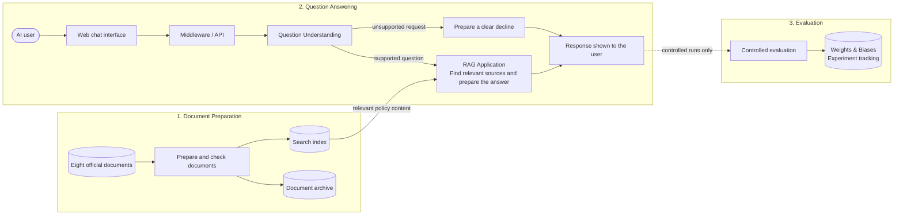

# System Architecture Design Document

| Team | Sprint | Status | Last updated | Updated by |
|---|---|---|---|---|
| Rag Against The Machine | Sprint 1 | proposed | 2026-10-27 | Elif Yeşim Koçoğlu |

This document describes the proposed architecture at a technology-neutral level. Exact products, models, versions and cloud machine types will be selected after the related spikes. Accepted choices will then be added to this document and the relevant SBOM.

## 1. Summary

The system is a Turkish question-answering assistant for a fixed collection of eight official documents on Türkiye's public-sector AI policy. It uses retrieval-augmented generation (RAG): the system first finds relevant passages in the approved collection and then generates an answer from those passages only.

The architecture has three parts:

1. **Document preparation:** approved documents are collected, checked, cleaned and prepared for search.
2. **Question answering:** requests pass through the web interface, middleware/API and a question-understanding step before entering the RAG application.
3. **Evaluation:** controlled baseline and experiment runs measure system quality, with configurations and results recorded in Weights & Biases.

The system returns Turkish answers with traceable source information. It gives a clear decline instead of guessing when a request is outside the collection or asks for a case-specific compliance judgement. It does not use an external commercial language-model API and does not store persistent conversation history.

## 2. Goals and non-goals

### Goals

- Answer Turkish questions using evidence from the approved eight-document collection.
- Present the supporting document, article or section, page where available, official URL, publication date and legal status.
- Support up to five user questions, including follow-up questions, during one open chat.
- Understand and prepare a request before it reaches retrieval.
- Decline unsupported and case-specific questions without generating a guess.
- Evaluate retrieval, answer correctness, citation support, legal-status accuracy, refusal behaviour and latency.
- Keep prompts, retrieval settings and experiment parameters under version control.
- Operate within the fixed $100 Google Cloud credit.

### Non-goals

- Giving case-specific legal or administrative advice.
- Predicting future policy or legislation.
- Answering from documents outside the approved collection.
- Automatically monitoring or updating official documents.
- Fine-tuning or training a foundation model.
- Creating user accounts or storing persistent conversation history.
- Providing a mobile application, high availability, automatic scaling or continuous 24/7 operation.

## 3. System architecture diagram

**Version:** v1 (2026-10-27)

The high-level architecture separates document preparation, question answering and controlled evaluation. Middleware/API and Question Understanding are separate logical responsibilities but may run in the same application process. The RAG application retrieves evidence, generates grounded answers and validates source references. Responses return through the middleware/API and web interface. Controlled evaluation is a project activity rather than part of every live conversation, and its configurations and results are recorded in Weights & Biases.

### Detailed RAG data flow

The detailed view expands the processing performed during document indexing, question answering and controlled evaluation. Document and question embeddings are created by the same selected embedding component. Question Understanding and grounded answer generation use the selected self-hosted language model with separate instructions.

```mermaid
flowchart LR
    subgraph INDEXING["A. Document Indexing"]
        direction TB
        SOURCES["Approved documents"]
        EXTRACT["Extract and clean text"]
        CHUNKS["Chunk text and preserve source metadata"]
        DOCEMBED["Create document embeddings"]
        VINDEX[("Search index<br/>Passages, embeddings and source metadata")]

        SOURCES --> EXTRACT
        EXTRACT --> CHUNKS
        CHUNKS --> DOCEMBED
        DOCEMBED --> VINDEX
    end

    subgraph RUNTIME["B. Question Answering"]
        direction TB
        U(["AI user"])
        WEB["Web chat interface"]
        API["Middleware / API"]
        UNDERSTAND["Question Understanding<br/>Scope check and query enhancement"]
        QEMBED["Create question embedding"]
        SEARCH["Search the index"]
        REQUEST["Combine the clarified question with retrieved evidence"]
        GENERATE["Generate grounded answer"]
        VERIFY["Check sources and format response"]
        REFUSE["Prepare a clear decline"]
        OUTPUT["Response shown to the user"]

        U --> WEB
        WEB --> API
        API --> UNDERSTAND
        UNDERSTAND -->|"supported question"| QEMBED
        UNDERSTAND -->|"unsupported request"| REFUSE
        QEMBED -->|"search representation"| SEARCH
        SEARCH -->|"retrieved passages and source metadata"| REQUEST
        REQUEST --> GENERATE
        GENERATE --> VERIFY
        VERIFY --> OUTPUT
        REFUSE --> OUTPUT
    end

    subgraph EVALUATION_DETAIL["C. Evaluation"]
        direction TB
        EVAL["Evaluate controlled runs"]
        WANDB[("Weights & Biases<br/>Experiment tracking")]

        EVAL -->|"configuration and results"| WANDB
    end

    VINDEX -->|"indexed policy content"| SEARCH
    OUTPUT -.->|"measurements from controlled runs only"| EVAL
```

During indexing, approved documents are extracted, cleaned, divided into passages, embedded and stored with their source metadata. During question answering, Question Understanding determines whether a request is supported and clarifies eligible questions. The clarified text is retained by the application while its embedding is used to search the index. Retrieved passages are then combined with the clarified question to generate a grounded answer, after which source references are checked and the response is formatted. Controlled evaluation consumes responses produced during scheduled baseline and experiment runs and records their configurations and measurements in Weights & Biases.

## 4. Components

| Component | Responsibility | Technology and version | SBOM entry |
|---|---|---|---|
| AI user | Submits Turkish questions and reads answers and sources through a browser. | Standards-compatible browser | N/A — user-controlled |
| Eight official documents | Provide the fixed public-policy content and source metadata. | Official PDF and HTML publications | Third-Party Dataset Register |
| Document preparation | Imports approved files, verifies them, extracts and cleans text, preserves document structure and creates searchable passages with source metadata. | Python-based processing pipeline; exact libraries and versions pending spikes | Project code and selected dependencies |
| Document archive | Stores approved original files and reproducible processed records. | Cloud object storage; exact configuration pending | Managed-service record and client dependency if used |
| Search index | Stores searchable passages and their document, section, page, date, legal-status and URL metadata. | Vector database or equivalent search index; exact product and version pending | Pending decision |
| Web chat interface | Collects questions and displays answers, sources, legal status, dates and collection date. It does not access retrieval or model components directly. | Python-compatible web UI framework; exact framework and version pending | Pending decision |
| Middleware / API | Receives questions from the web interface, enforces the five-question chat limit, passes them to question understanding and returns the resulting response. | Python application layer; exact framework and implementation pending spike | Project code and selected dependencies |
| Question understanding | Checks whether a question can be handled and clarifies supported questions, including follow-ups from the current chat, for search. | Python application logic using the selected self-hosted open-source instruction model; exact implementation pending spike | Project code, prompt record, selected dependencies and AI SBOM entry pending |
| Embedding component | Creates compatible representations for prepared document passages and supported user questions so that relevant passages can be found. | Multilingual embedding model and inference library; exact model, revision and version pending spike | AI SBOM and selected runtime dependency pending |
| RAG application | Coordinates question embedding and search, combines the clarified question with retrieved evidence, generates the answer with the selected self-hosted model and checks its sources. | Python application code, multilingual retrieval and an open-source instruction model and runtime; exact framework, model and retrieval choices pending | Project code, selected dependencies, AI SBOM and runtime entries pending |
| Clear-decline handler | Produces a consistent refusal for unsupported or case-specific requests without sending them to retrieval or answer generation. | Application rules and response templates | Project code and prompt/template records |
| Final response | Represents either a source-backed answer or a clear decline in a consistent structure. | Application response schema; exact implementation pending | Project code |
| Controlled evaluation | Runs the fixed evaluation set through the normal application flow and calculates retrieval, answer, citation, legal-status, refusal and latency measurements. | Project evaluation scripts; exact dependencies pending | Project code and selected dependencies |
| Weights & Biases | Tracks controlled baseline and later experiment runs. Each run records its Git commit, committed configuration, model and retrieval identifiers, per-test-case measurements and aggregate results. | Weights & Biases; exact client version to be pinned when configured | Client dependency and managed-service record pending |

## 5. Design details

### Data pipeline

1. A document manifest identifies each of the eight approved documents by its official URL, licence or terms-of-use information, publication or version date, collection date and file hash.
2. Approved source files are copied to controlled document storage so that the collection can be reproduced.
3. Text is extracted page by page. Content that cannot be extracted reliably is handled through a controlled manual process and independently checked.
4. Cleaning preserves Turkish characters, headings, article numbers, action or measure numbers, page numbers and document boundaries.
5. Text is divided primarily at meaningful source boundaries such as headings, articles, measures and action items. Size and overlap rules are used only when a source section is too long.
6. Each searchable passage keeps at least the document identifier and title, issuer, legal status, publication and collection dates, article or section, page where available, official URL and passage text.
7. The selected embedding component creates a document embedding for every prepared passage.
8. The search index stores each passage, its embedding and its source metadata together.
9. The collection is rebuilt only when an approved source or processing configuration changes. Automatic monitoring and updating remain out of scope.

### Model

The web interface does not communicate directly with the search index, retrieval logic or language model. Every question first enters the middleware/API, which passes it to the question-understanding step.

Question understanding remains outside the RAG application. It uses the selected self-hosted language model with separate instructions to:

- determine whether the assistant can handle the question;
- enhance supported questions and turn follow-ups into clear standalone questions for search; and
- direct unsupported requests to the clear-decline handler.

The middleware/API coordinates this flow and returns the resulting response to the web interface. These responsibilities may be implemented in the same Python application even though they are shown separately in the logical design.

Supported questions enter the RAG application, which performs the following internal steps:

1. uses the selected embedding component to create a search representation of the clarified question;
2. searches the index for the most relevant passages and source metadata;
3. combines the clarified question with the retrieved passages and answer instructions;
4. calls the self-hosted open-source language model, which produces a draft answer only from the supplied passages;
5. checks that the draft answer's source references correspond to retrieved passages; and
6. attaches verified document information, legal status, dates and official links.

Unsupported requests bypass retrieval and the answer-generation call and are sent to the clear-decline handler. Both paths produce the same final response structure.

Each open chat accepts at most five user questions, including follow-up questions. The current chat context is held temporarily only for those exchanges and is discarded when the chat is reset or the application session ends. It is not written to persistent storage. A user who reaches the limit must begin a new chat.

### Evaluation

Controlled evaluation uses the normal application flow and receives its final structured responses. It is performed during planned baseline and experiment runs rather than during normal user conversations. Each W&B run records:

- the Git commit and committed configuration;
- the language-model, embedding and retrieval identifiers;
- a test-case ID without personal data;
- retrieval success against the expected document and section;
- answer correctness;
- citation support;
- legal-status accuracy;
- refusal behaviour;
- end-to-end latency; and
- aggregate results for the complete run.

Source documents, live user questions, personal data, complete conversations and complete prompts are not uploaded to W&B. Full test questions and generated answers remain in the controlled project evaluation files; W&B stores their test-case IDs and measurements so that runs can be compared without turning live conversations into evaluation data.

### Interfaces

| From | To | What passes | Format or protocol |
|---|---|---|---|
| Eight official documents | Document preparation | Approved source files and source information | HTTPS download or controlled manual import |
| Document preparation | Document archive | Original files and processed records | Cloud storage interface |
| Document preparation | Search index | Searchable passages and source details | Database client or managed-service API |
| Document preparation | Embedding component | Prepared passages and their source metadata | Internal model interface |
| Embedding component | Search index | Document embeddings, passages and source metadata | Database client or managed-service API |
| AI user ↔ Web chat interface | — | Turkish question and displayed response | Browser interaction over HTTPS |
| Web chat interface ↔ Middleware / API | — | Current question and structured response | Application request and response |
| Middleware / API | Question understanding | Current question and temporary context from the current five-question chat | Internal application interface |
| Question understanding | RAG application | Supported question in a clear standalone form | Internal application interface |
| Question understanding | Clear-decline handler | Unsupported request category | Internal application interface |
| RAG application | Embedding component | Clarified question for search representation | Internal model interface |
| RAG application ↔ Search index | — | Search request and relevant passages with source details | Search client or managed-service API |
| RAG application | Final response | Source-backed answer and verified source information | Internal response object |
| Clear-decline handler | Final response | Decline message and refusal category | Internal response object |
| Final response | Controlled evaluation | Answers or declines and their measurements from controlled runs only | Project evaluation interface |
| Controlled evaluation | Weights & Biases | Git commit, configuration, test-case IDs, measurements and aggregate results | W&B API |

### Deployment

During development, document preparation and interface work may run on team computers or scheduled cloud compute. End-to-end model experiments and the MVP will use Google Cloud because the team does not have a suitable local GPU and has a fixed $100 Google Cloud credit.

The MVP is expected to use the smallest scheduled GPU-capable Google Cloud environment that meets the measured model and latency needs. The exact machine type, GPU, region, UI framework, search-index product, language model and inference runtime remain open until the related spikes are complete.

Only the web application endpoint will be reachable by pilot users. The middleware, search index, model runtime and credentials will remain private. Secrets will be stored outside the Git repository. Cloud compute will be stopped outside scheduled development, evaluation and demonstration periods.

High availability, automatic scaling and continuous public operation are outside the MVP.

## 6. Decisions

### D1: Separate middleware/API and question understanding before the RAG application

**Context:** User requests require a controlled application entry point and a question-understanding step before retrieval. The UI must not call retrieval directly.

**Options considered:**

| Option | Pros | Cons |
|---|---|---|
| Web UI → middleware/API → question understanding → RAG application | Clear responsibilities; one controlled entry point; question understanding remains outside the RAG application | Adds one processing stage and may increase latency |
| Web UI directly calling RAG | Smaller prototype | Mixes input handling and retrieval responsibilities |
| Separate deployed services for middleware and question understanding | Strong deployment separation | Adds unnecessary operational complexity for the MVP |

**Decision:** Use middleware/API and Question Understanding as separate logical components before the RAG application. They may share one application process. Question Understanding and answer generation use the same self-hosted language model with separate instructions. Unsupported requests go to the decline handler before retrieval.

**Why:** This distinguishes application request handling from model-assisted interpretation while keeping the MVP deployment simple.

**Consequences:** Middleware and question understanding must be testable separately even if they share one application process. A supported question can require one model call for understanding and another for answer generation.

**Evidence:** A spike will demonstrate one supported question, one follow-up and one unsupported request through the proposed flow and measure the added latency of model-assisted question understanding.

**Owner and date:** Utku Uçar and Deniz Şenkutlu, 2026-10-25.

**Status:** proposed

### D2: Use reproducible, structure-aware document preparation

**Context:** Long policy documents and selected sections must remain traceable to their original structures and pages.

**Options considered:**

| Option | Pros | Cons |
|---|---|---|
| Page-aware extraction and structure-aware splitting | Preserves traceability and meaningful policy units | Some content may require manual correction |
| Fixed-size splitting only | Easy to implement | Can break articles, headings and measures |
| OCR for every document | Handles scanned pages | Adds errors and cost where text extraction already works |

**Decision:** Use page-aware extraction and meaningful source boundaries, with configurable size and overlap only as fallbacks.

**Why:** This preserves the source information required for citations without unnecessary processing.

**Consequences:** Difficult pages and manually prepared content require an independent quality check.

**Evidence:** The ingestion spike will compare sampled passages and their metadata with the official documents.

**Owner and date:** Utku Uçar, 2026-10-25.

**Status:** proposed

### D3: Start with multilingual semantic retrieval

**Context:** The system needs Turkish semantic search and metadata-based filtering within a small project budget.

**Options considered:**

| Option | Pros | Cons |
|---|---|---|
| Multilingual semantic retrieval | Manageable baseline; captures similar meanings | May miss exact terms or article numbers |
| Combined semantic and keyword retrieval | Handles meaning and exact terms | Adds implementation and tuning work |
| Retrieval plus a separate reranker | May improve ordering | Adds another model and latency |

**Decision:** Begin with multilingual semantic retrieval and source-metadata filtering. Select the model and search-index product after comparative spikes.

**Why:** It provides the smallest measurable baseline while leaving additional retrieval methods evidence-driven.

**Consequences:** Keyword retrieval or reranking may be added later if the baseline misses the agreed target.

**Evidence:** The retrieval spike will compare candidate configurations against expected documents and sections in the evaluation set.

**Owner and date:** Elif Yeşim Koçoğlu, 2026-10-25.

**Status:** proposed

### D4: Use a self-hosted open-source language model

**Context:** Turkish question understanding and grounded answer generation are required without depending on a paid external language-model API.

**Options considered:**

| Option | Pros | Cons |
|---|---|---|
| Self-hosted open-source instruction model | Keeps inference under team control; no per-token API charge | Requires compute capacity and operational work |
| Smaller self-hosted model | Lower compute cost | May reduce grounded-answer quality |
| Hosted commercial model API | Easy to use | Adds an external dependency and usage cost |

**Decision:** Evaluate open-source instruction models and inference runtimes that fit the available GPU and budget. Use the selected model for question understanding and answer generation with separate instructions. Do not select an exact model before the spike.

**Why:** Turkish quality, groundedness, refusal behaviour, latency and memory use must be measured rather than assumed.

**Consequences:** The accepted model, revision, quantization and runtime will be pinned in configuration and the AI SBOM.

**Evidence:** The generation spike will measure question understanding, grounded Turkish answers, refusal behaviour, latency and GPU memory.

**Owner and date:** Deniz Şenkutlu and Elif Yeşim Koçoğlu, 2026-10-25.

**Status:** proposed

### D5: Use scheduled Google Cloud compute

**Context:** The team has no suitable local GPU and must remain within the fixed $100 Google Cloud credit.

**Options considered:**

| Option | Pros | Cons |
|---|---|---|
| One scheduled GPU-capable cloud environment | Simple deployment and controlled cost | Limited availability and dependent on quota |
| Local-only deployment | No cloud spending | Insufficient compute and limited pilot access |
| Multiple managed services or Kubernetes | Better separation and scaling | Too complex and expensive for the MVP |

**Decision:** Use the smallest scheduled Google Cloud compute configuration that passes the model and end-to-end spikes. Keep machine type, GPU and region open until quota, performance and cost are verified.

**Why:** It meets the compute and browser-access needs without assuming continuous operation.

**Consequences:** Billing alerts, shutdown procedures and limited demonstration windows are required.

**Evidence:** The deployment spike will verify quota, model startup, one end-to-end question and projected credit usage.

**Owner and date:** Elif Yeşim Koçoğlu, 2026-10-25.

**Status:** proposed

### D6: Use Weights & Biases for controlled experiment tracking

**Context:** Weights & Biases is the required experiment-tracking platform for the project. Experiment tracking must still avoid uploading personal data, live conversations and unnecessary source content.

**Options considered:**

| Option | Pros | Cons |
|---|---|---|
| W&B with configuration, test-case IDs, measurements and aggregate results | Uses the required platform; supports reproducibility and run comparison without storing live conversations | Requires a reviewed logging schema |
| W&B with aggregate results only | Minimizes stored data | Makes individual test failures harder to compare |
| W&B with complete prompts, answers and conversations | Detailed debugging | Stores more content than required and may capture prohibited data |

**Decision:** Use Weights & Biases for controlled baseline and experiment runs. Record the Git commit, committed configuration, model and retrieval identifiers, test-case IDs, per-case measurements and aggregate results. Do not send live user conversations, personal data, source documents or complete prompts.

**Why:** This supports reproducibility while following data-minimization constraints.

**Consequences:** Evaluation files remain the source of full test questions and answers. The W&B logging schema must be reviewed before the first baseline run.

**Evidence:** An evaluation spike will confirm that a run can be traced to its Git commit and configuration without prohibited content.

**Owner and date:** All Data Scientists, 2026-10-25.

**Status:** proposed

## 7. Open design areas

- Text-extraction library and exact version.
- Passage size, overlap and document-specific splitting rules.
- Multilingual retrieval model, revision and search representation.
- Vector database or equivalent search-index implementation.
- Web-interface and middleware frameworks.
- Question-understanding instructions and implementation.
- Open-source language model, revision, quantization and inference runtime.
- Retrieval result count and acceptance threshold.
- Whether keyword retrieval or reranking is required.
- Google Cloud machine type, GPU, region and operating schedule.
- W&B workspace access, client version and retention policy.

## 8. Change log

| Version | Date | Change | Pull request |
|---|---|---|---|
| v1 | 2026-10-27 | First proposed system architecture with high-level and detailed RAG views | — |

## Checklist before submitting

- Every box in the high-level architecture diagram has a corresponding row in Components.
- Every arrow in the high-level architecture diagram has a corresponding row in Interfaces.
- Every stage in the detailed processing flow is assigned to Document preparation, the Embedding component, Question understanding, the RAG application or Controlled evaluation.
- Middleware/API and question understanding are outside the RAG application.
- The web interface does not connect directly to retrieval or the model.
- The diagrams use plain-language information flow rather than low-level data types.
- Every accepted technology is covered by a decision in section 6 and will be recorded in the relevant SBOM under the same name and version.
- Every unresolved implementation choice appears in Open design areas.
- The diagram version matches the latest change-log entry.

## References

1. [GitLab Design Document Template](https://gitlab.com/gitlab-com/content-sites/handbook/-/blob/main/content/handbook/engineering/architecture/design-documents/_template.md)
2. [GitLab Architecture Design Workflow](https://handbook.gitlab.com/handbook/engineering/architecture/workflow/)
3. [Mermaid flowchart syntax](https://mermaid.js.org/syntax/flowchart.html)
